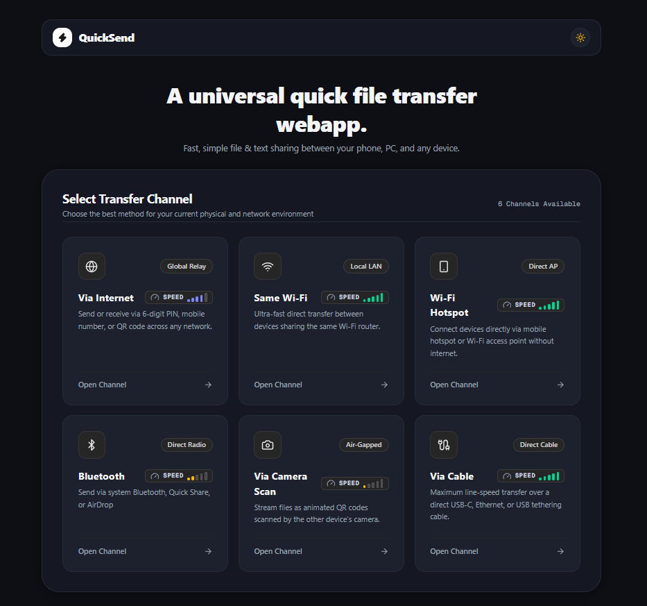

<div align="center">
  
  <h1>QuickSend</h1>

  <p>
    <a href="https://quicksend.vercel.app"></a>
    <a href="https://nextjs.org"></a>
    <a href="https://www.typescriptlang.org"></a>
    <a href="https://tailwindcss.com"></a>
    <a href="https://webrtc.org"></a>
    
    
  </p>

  <h3>The Zero-Login, Ephemeral Peer-to-Peer Transfer Engine for Web &amp; Mobile.</h3>

  <p>
    Transfer files of any size, directories, code snippets, or clipboard text between devices in seconds.<br />
    Direct browser-to-browser P2P with WebRTC, local subnet radar, offline hotspot, native Bluetooth/Quick Share, and air-gapped optical QR streams in one app.<br />
    <strong>Zero server uploads — files stay on your device until direct P2P transfer.</strong>
  </p>

  <p>
    <a href="https://quicksend.vercel.app">
      
    </a>
  </p>

  <br />

  <a href="https://quicksend.vercel.app">
    
  </a>
</div>

---

## ⚡ About QuickSend

In university computer labs, research facilities, offices, and shared workstations, transferring a file or link between a public machine and a personal phone or laptop is notoriously frustrating:

- **Security & Privacy Risks:** Logging into personal accounts (WhatsApp Web, Telegram, Google Drive, email) on untrusted shared computers exposes passwords, session tokens, and personal messages to keyloggers and shoulder surfing.
- **Port Lockdowns & Hardware Limits:** Physical USB flash drives carry malware risks and are often disabled by administrators.
- **Strict Network Environments:** University and corporate networks often enforce rigid firewalls, client isolation, or intermittent external internet connectivity.

**QuickSend** solves this with an instant, multi-modal transfer engine that runs entirely in the browser. Using direct WebRTC data channels, local subnet discovery, offline hotspot pairing, native Bluetooth/Quick Share handoff, animated optical QR streams, and wired cable links, QuickSend guarantees fast, secure, peer-to-peer data transfer in any physical or network environment — with **zero server-side data retention**.

---

## 📡 6 Versatile Transfer Channels

QuickSend automatically detects your connectivity and adapts to your environment, providing 6 specialized transfer channels:

| Channel | Connectivity | Handshake Method | Ideal Use Case |
| :--- | :--- | :--- | :--- |
| **🌐 Via Internet** | Public Internet | 6-digit PIN, Mobile #, or Dynamic QR | Remote cross-network transfers between lab PCs and personal phones via WebRTC (`0.peerjs.com` + `/api/signal` dual-transport) with smart 15s ICE watchdog. |
| **📡 Same Wi-Fi** | Local Wi-Fi / LAN | Automatic subnet radar (`/api/discover`) | High-speed local transfers with visual device cards, animal avatars (🦊 Curious Fox, 🐬 Swift Dolphin), and 1-tap beam requests. |
| **📶 Wi-Fi + Hotspot** | Offline / No Internet | Mobile Hotspot QR (`WIFI:S:...`) | Zero-internet field environments and isolated workstations using mobile AP credentials, 1-tap Android tethering shortcuts, and offline PWA. |
| **🔵 Bluetooth** | Direct Radio | OS Share Sheet (`navigator.share`) | Send files via native Bluetooth, Quick Share, or AirDrop with hardware BLE sensor connectivity (`navigator.bluetooth`). |
| **📷 Via Camera Scan** | 100% Air-Gapped | Animated Optical QR Stream | Completely isolated environments with zero radio emissions. Stream data via Base45 animated QRs with XOR parity recovery. |
| **🔌 Via Cable** | Direct Cable Link | USB-C / Ethernet / Tethering | Maximum line-speed transfers (1–10 Gbps) over wired connections with host candidate priority, plus WebUSB and Web Serial hardware support. |

---

## ✨ Key Features

- 🔒 **Zero Server Uploads:** Files never pass through or touch an intermediary cloud server. Data stays strictly on your local device until direct P2P transfer begins.
- 🔓 **Zero Accounts & Zero Logins:** No email, phone number, or password required. Start transferring immediately upon opening the page.
- 🛡️ **100% Ephemeral & End-to-End Encrypted:** Direct peer-to-peer transmission secured with `WebRTC DTLS/SRTP`.
- 📦 **Multi-File Batch Queue & Disk Streaming:** Beam entire folders or batches of files sequentially over an open channel. Large payloads (> 100MB) stream directly to disk using the File System Access API without browser tab crashes.
- ⏱️ **Smart Transfer Time Estimation:** Dynamic, channel-aware estimate badges calculate expected transfer durations before sending based on payload size and channel throughput.
- 🩺 **Real-Time Connection Diagnostics:** Expandable diagnostic drawer displaying ICE connection states, candidate pair types (host, srflx, relay), signaling status, and one-click copyable debug reports.
- 📱 **Offline PWA & Service Worker:** Installable Progressive Web App (PWA) with client-side asset caching that runs reliably even without an active internet connection.

---

## 🏗️ Architecture & How It Works

QuickSend prioritizes direct device-to-device communication without storing any data on servers:

```
[ Sender Device ]                                            [ Receiver Device ]
       |                                                              |
       |--- 1. Register Session (PIN / QR / Radar) ----------------->| (Signaling via WebSocket/REST)
       |                                                              |
       |<-- 2. Exchange WebRTC Offer / Answer / ICE Candidates ------>| (Encrypted SDP exchange)
       |                                                              |
  ==========================================================================
              DIRECT PEER-TO-PEER ENCRYPTED DATA CHANNEL ESTABLISHED
  ==========================================================================
       |                                                              |
       |--- 3. Chunk Payload (64 KB packets + SHA-256) -------------->| (Backpressure regulated)
       |--- 4. Direct Disk Stream (File System Access API) ---------->| (Zero tab memory bloat)
       |                                                              |
       |<-- 5. Transfer Complete & Checksum Verified -----------------|
```

- **Ephemeral Signaling:** Rooms exist only in memory with a short TTL. Once the WebRTC peer connection is established, signaling is terminated.
- **Pure P2P Data Path:** All file chunks flow directly between browser instances over DTLS 1.3 encrypted data channels.

---

## 🛠️ Tech Stack

| Category | Technology | Purpose |
| :--- | :--- | :--- |
| **Framework** | [Next.js 16](https://nextjs.org/) (App Router, Turbopack) | Production React framework with serverless edge handlers and Turbopack compiler. |
| **UI Library** | [React 19](https://react.dev/) | Modern concurrent UI components with client hooks and Suspense streaming. |
| **Styling** | [Tailwind CSS 4](https://tailwindcss.com/) | Modern glassmorphic dark/light UI tokens, responsive grid layouts, and micro-animations. |
| **Icons** | [Lucide React](https://lucide.dev/) | Clean, consistent SVG icon system across all navigation and channel cards. |
| **P2P Transport** | WebRTC (`RTCDataChannel`) + PeerJS | Browser-to-browser encrypted data transport with dual cloud broker and REST signaling. |
| **Optical Engine** | `html5-qrcode`, `jsQR`, `qrcode.react` | High-contrast animated QR code generator, multi-layout scanner, and Deflate + Base45 codec. |
| **Forward Error Correction** | XOR Parity Stride Engine | Recovers dropped frames in optical streams with word recovery codes. |
| **Hardware APIs** | File System Access, Web Share, Web Bluetooth | Native disk writing, OS share sheet handoff, and BLE peripheral interfacing. |

---

## 💻 Quick Start & Local Development

### Prerequisites
- [Node.js](https://nodejs.org/) (v18.18.0 or newer; Node 20+ tested)
- npm, pnpm, or yarn

### Installation & Run

1. **Clone the repository:**
   ```bash
   git clone https://github.com/inbox-hasibur/quicksend.git
   cd quicksend
   ```

2. **Install dependencies:**
   ```bash
   npm install
   ```

3. **Start development server:**
   ```bash
   npm run dev
   ```

4. **Open in your browser:**
   Navigate to [http://localhost:3000](http://localhost:3000).

---

## 🔒 Security & Privacy Guarantees

- **Zero Cloud Storage:** QuickSend does not operate any file storage, S3 buckets, or persistent user databases. Files reside exclusively in device RAM or local disk.
- **End-to-End Encryption:** All peer-to-peer data channels use DTLS 1.3 with SRTP encryption keys negotiated directly between peers.
- **Air-Gapped Optical Streaming:** For ultra-sensitive files in isolated labs, Mode 5 transmits data strictly via visual light (screen to camera) with zero electromagnetic emissions.
- **Zero Tracking:** No tracking cookies, third-party analytics scripts, or telemetry trackers.

---

## 📄 License & Credits

- **License:** [MIT License](LICENSE)
- **Author & Maintainer:** [IncodeBD / Hasibur](https://github.com/inbox-hasibur)
- **Live Deployment:** [quicksend.vercel.app](https://quicksend.vercel.app)
