# QuickSend: Codebase Map & Dependency Graph

> **Last Updated:** Sprint 4 Complete (Mode 4 Bluetooth, Polish, History & Vercel Deployment)  
> **Target Deployment:** [quicksend.vercel.app](https://quicksend.vercel.app)  
> **Module Path Alias:** `@/*` -> `./src/*`

This document provides a high-density, comprehensive map of the repository's modules, files, dependencies, exports, and browser API integrations. Any AI coding assistant or engineer can read this single document to understand the codebase without scanning raw files.

---

## 1. System Dependency & Architecture Graph

```mermaid
flowchart TD
    subgraph Browser_APIs["Browser & Hardware Runtime APIs"]
        RTC["WebRTC (RTCDataChannel, RTCPeerConnection)"]
        BLE["Web Bluetooth GATT Client (navigator.bluetooth)"]
        Share["Web Share API (navigator.share with files)"]
        NetStat["Network Information (navigator.onLine, online/offline events)"]
        Cam["MediaDevices / Camera (HTML5 QR Scanner)"]
        SW["Service Worker (public/sw.js, CacheStorage)"]
    end

    subgraph External_Libraries["Installed Core Packages"]
        NextJS["Next.js 16 (App Router, Turbopack, Route Handlers)"]
        React19["React 19 (useSyncExternalStore, Client Components)"]
        Lucide["lucide-react (Icons: Globe, Wifi, Smartphone, Bluetooth, Zap, etc.)"]
        QRGen["qrcode.react (QRCodeSVG Generator)"]
        QRScan["html5-qrcode (Html5Qrcode Camera Scanner)"]
        Tailwind["Tailwind CSS v4 (@tailwindcss/turbopack)"]
        Vitest["Vitest v5 + happy-dom (115 Passing Tests across 19 Suites)"]
        PeerJS["peerjs (Global WebRTC Peer Connection & Real-Time Broker)"]
    end

    subgraph App_Routes["src/app/ (App Router & Route Handlers)"]
        Layout["layout.tsx (Root Shell, Font Injection)"]
        Page["page.tsx (5-Mode Home Hub & URL Param Receiver)"]
        Manifest["manifest.ts (PWA Web App Manifest)"]
        HealthAPI["api/health/route.ts (Health Check & Runtime Telemetry)"]
        SignalAPI["api/signal/route.ts (Room Signaling & Ephemeral Relay)"]
        DiscoverAPI["api/discover/route.ts (Same Wi-Fi Local Discovery & Presence)"]
        SignalAPITests["api/signal/__tests__/route.test.ts (API Route Tests)"]
        DiscoverAPITests["api/discover/__tests__/route.test.ts (Discovery Route Tests)"]
    end

    subgraph Src_Components["src/components/ (UI & Presentation Components)"]
        AppHdr["AppHeader.tsx (Logo, Session History Pill, Status Badge)"]
        ModeSel["ModeSelector.tsx (5-Mode Grid & Active Panels)"]
        NetBadge["NetworkStatusBadge.tsx (Online/Offline Real-Time Pill)"]
        SWReg["ServiceWorkerRegister.tsx (PWA /sw.js Registration)"]
        InternetCard["InternetSharingCard.tsx (Mode 1 Controller: Dual-Transport PIN/QR)"]
        SameNetCard["SameNetworkCard.tsx (Mode 2 Controller: Local Radar & Device Beaming)"]
        CameraCard["CameraStreamCard.tsx (Mode 5 Controller: Air-Gapped Optical QR Stream)"]
        HotspotCard["HotspotAssistantCard.tsx (Mode 3 Controller: Hotspot QR & Wizard)"]
        NearbyCard["NearbyShareCard.tsx (Mode 4 Controller: Quick Share & BLE Client)"]
        OpticalModal["OpticalHandshakeModal.tsx (Camera-to-Camera Optical QR Handshake)"]
        DropzoneComp["Dropzone.tsx (Drag & Drop Files / Text Paste Tabs)"]
        QRDisp["QRCodeDisplay.tsx (SVG QR Generator & 6-Digit PIN Display)"]
        QRModal["QRScannerModal.tsx (Camera Viewport Scanner Dialog)"]
        TransferMod["TransferModal.tsx (Incoming Prompt, Speed, Progress Bar)"]
        SpeedInd["SpeedIndicator.tsx (Solid High-Contrast Speed Indicator)"]
        HistoryMod["TransferHistoryModal.tsx (Ephemeral Session Transfer Drawer)"]
        FileTypeBdg["FileTypeBadge.tsx (Color-coded file type chips PDF, IMG, DOC, etc.)"]
        SegControl["SegmentedControl.tsx (Tactile Pill Track & Keyboard Navigation)"]
        ThemeTgl["ThemeToggle.tsx (Tactile Dark/Light Mode Toggle)"]
    end

    subgraph Src_Hooks["src/hooks/ (Custom React Hooks)"]
        UseNet["useNetworkStatus.ts (useNetworkStatus, useBrowserCapabilities)"]
        UseRTC["useWebRTC.ts (useWebRTC: Peer Connection & Stream Controller)"]
        UseLocalDisc["useLocalDiscovery.ts (Radar Presence & Peering)"]
        UseNearby["useNearbyShare.ts (useNearbyShare: Web Share & Web-BLE Client)"]
        UseHist["useTransferHistory.ts (useTransferHistory: Ephemeral Session Storage)"]
        UseThm["useTheme.ts (useTheme: Light / Dark Mode Controller)"]
    end

    subgraph Src_Lib["src/lib/ (Protocols, Pure Logic & Utilities)"]
        ModeAvail["modeAvailability.ts (isModeAvailable, getModeStatus, getAllModesStatus)"]
        CodeGen["codeGenerator.ts (generateRoomCode, formatRoomCode, normalizeRoomCode)"]
        Chunker["chunker.ts (sliceBlobIntoChunks, reassembly, formatBytes, formatSpeed)"]
        DevId["deviceIdentity.ts (Device Avatars & Non-Colliding Identity)"]
        OptStream["opticalDataStream.ts (Visual Base64 Chunker & Optical Collector)"]
        SigClient["signalingClient.ts (SignalingClient: Room & Signal Polling Engine)"]
        SignalStore["signalStore.ts (Dual-Mode: Upstash Redis REST + Memory TTL)"]
        IceConfig["iceConfig.ts (Multi-Provider STUN Pool + TURN Config)"]
        DiskStream["diskStream.ts (File System Access Disk Streaming Fallback)"]
        WifiQr["wifiQr.ts (buildWifiQrString, parseWifiQrString, ANDROID_INTENTS)"]
        OpticalSdp["opticalSdp.ts (encodeOpticalSdp, decodeOpticalSdp, compactSdp)"]
    end

    subgraph Src_Types["src/types/ (TypeScript Domain Interfaces)"]
        ModeTypes["mode.ts (TransferMode, ModeStatus, BrowserCapabilities)"]
        SignalTypes["signaling.ts (PeerRole, SignalMessage, SignalingRoomState)"]
        TransferTypes["transfer.ts (FileMetadata, TransferPayloadHeader, TransferProgressState)"]
    end

    %% Active Wired Dependencies
    Layout --> SWReg
    Layout --> Page
    Page --> NetBadge
    Page --> ModeSel
    NetBadge --> UseNet
    ModeSel --> UseNet
    ModeSel --> ModeAvail
    ModeSel --> InternetCard
    ModeSel --> SameNetCard
    ModeSel --> CameraCard
    ModeSel --> HotspotCard
    ModeSel --> NearbyCard

    SameNetCard --> UseLocalDisc
    SameNetCard --> DevId
    CameraCard --> OptStream

    InternetCard --> UseRTC
    InternetCard --> DropzoneComp
    InternetCard --> QRDisp
    InternetCard --> QRModal
    InternetCard --> TransferMod
    InternetCard --> CodeGen
    InternetCard --> SegControl

    SameNetCard --> UseRTC
    SameNetCard --> DropzoneComp
    SameNetCard --> OpticalModal
    SameNetCard --> TransferMod
    SameNetCard --> OpticalSdp

    HotspotCard --> UseRTC
    HotspotCard --> DropzoneComp
    HotspotCard --> OpticalModal
    HotspotCard --> TransferMod
    HotspotCard --> WifiQr
    HotspotCard --> OpticalSdp
    HotspotCard --> QRGen

    OpticalModal --> QRGen
    OpticalModal --> QRModal
    OpticalModal --> OpticalSdp

    QRDisp --> QRGen
    QRDisp --> CodeGen
    QRModal --> QRScan
    QRModal --> CodeGen
    DropzoneComp --> Chunker
    DropzoneComp --> SegControl
    TransferMod --> Chunker
    UseRTC --> SigClient
    UseRTC --> Chunker
    UseRTC --> RTC
    SigClient --> SignalAPI
    SignalAPI --> CodeGen
    SignalAPI --> SignalTypes
```



---

## 2. Directory & Module Roles

| Directory | Role & Responsibilities | Key Dependencies |
| :--- | :--- | :--- |
| `src/app/` | Next.js App Router entry points, layout, metadata, and `/api/signal` room signaling handler. | `next`, `react`, `lucide-react` |
| `src/app/api/signal/` | Ephemeral serverless WebRTC room signaling and ICE/SDP message queue. | `src/lib/codeGenerator`, `src/types/signaling` |
| `src/components/` | Presentation & interactive units: 4-mode selector, Internet mode, Same-Network mode, Hotspot assistant, Optical Handshake modal, Dropzone, QR display/scanner, and transfer progress modal. | `lucide-react`, `qrcode.react`, `html5-qrcode`, `src/hooks/` |
| `src/hooks/` | Stateful React lifecycle hooks managing network connectivity (`useNetworkStatus`) and WebRTC P2P streams (`useWebRTC`). | `react`, `src/lib/` |
| `src/lib/` | Pure TypeScript domain functions: binary packet chunking, room code generators, Wi-Fi pairing QR strings, optical SDP compression, and mode availability evaluators. | `src/types/`, `vitest` |
| `src/types/` | Domain TypeScript interfaces: transfer headers, progress state, signaling messages, and mode contracts. | TypeScript |
| `public/` | Static SVG icons, PWA Service Worker (`sw.js`), and public web assets. | Browser CacheStorage |
| `documentation/` | Living project governance, sprint roadmaps, architecture specifications, and codebase maps. | Markdown Docs |

---

## 3. Comprehensive File Index

### 3.1 Application Routes & Route Handlers (`src/app/`)

#### `src/app/page.tsx`
- **Purpose:** Primary landing hub for "QuickSend". Wraps `<ModeSelector />` in `<Suspense>` so dynamic search params (`?room=123456`) hydrate cleanly while maintaining static prerendering.
- **Exports:** `default Home(): JSX.Element`

#### `src/app/globals.css`
- **Purpose:** Global styling, theme tokens (light & dark mode soft glass variables: `--bg`, `--surface`, `--surface-glass`, `--border-soft`, `--text`, `--text-muted`, `--accent`, `--accent-soft`, `--radius-card`, `--shadow-soft`), and utility classes (`.glass-card`, `.pill`, `.pill-active`).

#### `src/app/api/health/route.ts`
- **Purpose:** Public operational health endpoint returning `{ ok: true, app: "quicksend", storage: "redis" | "memory", timestamp }`.
- **Exports:** `GET(): Promise<NextResponse>`

#### `src/app/api/signal/route.ts`
- **Purpose:** Next.js Route Handler (`GET`, `POST`) for ephemeral room coordination, SDP offer/answer exchange, and ICE candidate delivery. Backed by `signalStore` adapter with clean HTTP status codes (`400`, `404`, `409`, `200`).
- **Exports:** `GET(request: Request)`, `POST(request: Request)`

#### `src/app/api/signal/__tests__/route.test.ts`
- **Purpose:** Integration test suite verifying room creation, room query by code, peer joining, signaling delivery, error codes, and cleanup.

---

### 3.2 UI Components (`src/components/`)

#### `src/components/SameNetworkCard.tsx`
- **Purpose:** Mode 2 Controller (Same Network Wi-Fi). Prioritizes internal host ICE candidates across the local router subnet and supports Camera-to-Camera Optical QR fallback when the local network has no internet.
- **Exports:** `SameNetworkCard(): JSX.Element`

#### `src/components/CameraStreamCard.tsx`
- **Purpose:** Mode 5 Controller (Via Camera Scan). Zero-network air-gapped file/text streaming via animated sequenced QR frames. Features React 19 lifecycle mutex protection, live webcam scanning with camera selector and multi-tier constraints fallback, compact 66-byte QR chunks (`QRCodeSVG` size 280, margin 3), live diagnostic frame indicator, and "Scan from Screenshot / Image" fallback.
- **Exports:** `CameraStreamCard(): JSX.Element`

#### `src/components/HotspotAssistantCard.tsx`
- **Purpose:** Mode 3 Controller (Wi-Fi Hotspot Transfer Engine). Dual-phase transfer architecture combining compact 1-tap Android Hotspot/Wi-Fi settings shortcuts, optional collapsible Wi-Fi QR code generator, live Hotspot Radar with 1-tap subnet beaming via `useLocalDiscovery(true)` + `useWebRTC("hotspot")`, and a collapsible offline 6-digit PIN / QR pairing backup for zero-cellular environments.
- **Exports:** `HotspotAssistantCard(): JSX.Element`

#### `src/components/NearbyShareCard.tsx`
- **Purpose:** Mode 4 Controller (Bluetooth & Quick Share). Honest 1-tap proximity sharing leveraging native OS share sheets (`navigator.share`) across Android Quick Share, Apple AirDrop, and Windows Bluetooth File Transfer with transfer history logging. Includes plain-English receiving instructions and a secondary collapsible Web Bluetooth GATT Client for microcontrollers and sensors.
- **Exports:** `NearbyShareCard(): JSX.Element`

#### `src/components/OpticalHandshakeModal.tsx`
- **Purpose:** Visual modal for 100% zero-internet optical WebRTC signaling. Displays compressed Offer/Answer QR codes and launches the camera scanner to exchange SDP descriptions directly across device screens.
- **Exports:** `OpticalHandshakeModal({ isOpen, role, localPayloadQr, onOfferScanned, onAnswerScanned, onClose }: OpticalHandshakeModalProps): JSX.Element | null`

#### `src/components/InternetSharingCard.tsx`
- **Purpose:** Mode 1 Interactive Controller. Manages Format (`PIN / Mobile / Keyword` or `QR Code`) and Role (`Send` or `Receive`). Offers flexible sender strategies (Auto 6-digit PIN, memorized Mobile Number, or Custom Keyword), dynamic room code lookup, dropzone payload selection, peer connection status, and transfer modal trigger.
- **Exports:** `InternetSharingCard({ initialRoomCode }: InternetSharingCardProps): JSX.Element`

#### `src/components/Dropzone.tsx`
- **Purpose:** Dual-mode payload selector with "Files" tab (multi-file drag-and-drop, format/size formatting, individual item removal) and "Text / Link" tab (instant clipboard snippet input).
- **Exports:** `Dropzone({ onSelectionChange }: DropzoneProps): JSX.Element`

#### `src/components/QRCodeDisplay.tsx`
- **Purpose:** High-contrast QR code renderer powered by `qrcode.react` (`QRCodeSVG`). Displays the dynamic room URL, 6-digit PIN with center hyphen, and one-click copy buttons.
- **Exports:** `QRCodeDisplay({ code, url }: QRCodeDisplayProps): JSX.Element`

#### `src/components/QRScannerModal.tsx`
- **Purpose:** In-browser camera QR code reader using `html5-qrcode`. Features permission handling, camera stream initialization, auto-parsing of room URLs (`?room=...`), and direct PIN extraction.
- **Exports:** `QRScannerModal({ isOpen, onClose, onScanSuccess }: QRScannerModalProps): JSX.Element | null`

#### `src/components/TransferModal.tsx`
- **Purpose:** Multi-state transfer progress dialog:
  1. *Waiting for Acceptance:* Receiver prompt with file/text preview and Accept/Decline actions.
  2. *Transferring:* Live progress bar, throughput speed (MB/s), and byte counts.
  3. *Completed:* Auto-download confirmation for files, or one-click copy button for text snippets.
  4. *Error / Declined:* Informative status feedback.
- **Exports:** `TransferModal({ progress, onAccept, onReject, onClose }: TransferModalProps): JSX.Element | null`

#### `src/components/FileTypeBadge.tsx`
- **Purpose:** Color-coded visual file-type badge component categorizing payloads into distinct semantic visual tags (`PDF` in red, `IMG` in purple, `DOC` in blue, `ZIP` in amber, `VID` in rose, `AUD` in cyan, `TXT` in emerald, and `FILE` fallback in neutral).
- **Exports:** `FileTypeBadge({ name, mimeType, className }: FileTypeBadgeProps): JSX.Element`

#### `src/components/AppHeader.tsx`
- **Purpose:** Soft glass header (`.glass-card`) displaying formatted client-side date (`useSyncExternalStore`), bold "QuickSend" title with Zap icon, session transfer history drawer toggle with counter badge, and live network status badge.
- **Exports:** `AppHeader(): JSX.Element`

#### `src/components/ModeSelector.tsx`
- **Purpose:** Clean, linear 4-channel workspace coordinator. In the default Home state, renders the 4 transfer option tiles in a tactile 2x2 grid directly styled after the reference card aesthetic (soft neutral `#F4F5F7` surface, uniform `rounded-2xl`, squircle icon, clean typography). Selecting any mode smoothly transitions into a focused workspace card with an "All Channels" return pill. No artificial sidebars or bottom navigation menus.
- **Exports:** `ModeSelector(): JSX.Element`

#### `src/components/SegmentedControl.tsx`
- **Purpose:** Reusable segmented option switch matching the tactile reference UI. Features a soft neutral pill track, pure white elevated active tab with subtle shadow, `role="tablist"` accessibility, and keyboard arrow key navigation.
- **Exports:** `SegmentedControl({ options, value, onChange, ariaLabel }: SegmentedControlProps): JSX.Element`

#### `src/components/SpeedIndicator.tsx`
- **Purpose:** Reusable transfer speed indicator with an explicit "Speed" text label, Lucide Gauge icon, and 5 solid high-contrast stepped pill segments (Emerald for 5/5, Indigo for 4/5, Blue for 3/5, Amber for 2/5). Clearly visible across both dark and light modes.
- **Exports:** `SpeedIndicator({ speedBars, total, className, showIcon, showLabel }: SpeedIndicatorProps): JSX.Element`, `getSpeedColorClass(speedBars: number): string`

#### `src/components/NetworkStatusBadge.tsx`
- **Purpose:** Live connection status pill reflecting online/offline state.

#### `src/components/ServiceWorkerRegister.tsx`
- **Purpose:** Registers `/sw.js` in production environments.

---

### 3.3 Custom Hooks (`src/hooks/`)

#### `src/hooks/useWebRTC.ts`
- **Purpose:** Complete WebRTC peer connection and DataChannel manager. Orchestrates signaling exchange, candidate queuing, 64KB binary chunk slicing with buffer backpressure, transfer progress calculation, and receiver file/text reassembly.
- **Exports:** `useWebRTC(): { role, roomId, roomCode, isConnected, progress, pendingHeader, startSender, startReceiver, sendPayload, acceptIncomingTransfer, rejectIncomingTransfer, cleanup }`

#### `src/hooks/useNetworkStatus.ts`
- **Purpose:** Hydration-safe network and browser capability detection hooks built with `useSyncExternalStore`.
- **Exports:** `useNetworkStatus(): boolean`, `useBrowserCapabilities(): BrowserCapabilities`

---

### 3.4 Protocol & Domain Libraries (`src/lib/`)

#### `src/lib/wifiQr.ts`
- **Purpose:** Standardized Wi-Fi configuration string generator (`WIFI:T:WPA;S:...`) and parser recognized by iOS/Android camera apps, with Android intent deep-links.
- **Exports:** `buildWifiQrString`, `parseWifiQrString`, `ANDROID_INTENTS`.

#### `src/lib/opticalSdp.ts`
- **Purpose:** WebRTC SDP compressor, host candidate filter, multi-frame sequenced QR frame splitter (`splitOpticalFrames`), and incremental stream collector (`OpticalFrameCollector`) supporting animated QR carousels, out-of-order frame reassembly, and camera-free manual copy/paste.
- **Exports:** `compactSdp`, `encodeOpticalSdp`, `decodeOpticalSdp`, `isOpticalSdp`, `isOpticalFrame`, `splitOpticalFrames`, `computeShortHash`, `OpticalFrameCollector`.

#### `src/lib/codeGenerator.ts`
- **Purpose:** Cryptographically secure 6-digit room PIN generation, custom key/mobile number preservation, normalization, and flexible 4–20 character room key validation.
- **Exports:** `generateRoomCode`, `formatRoomCode`, `normalizeRoomCode`, `isValidRoomCode`.

#### `src/lib/chunker.ts`
- **Purpose:** ArrayBuffer slicing (64KB chunks), async chunk generator, stream reassembly to Blob or UTF-8 text, and byte/speed formatting.
- **Exports:** `createFileHeader`, `createTextHeader`, `formatBytes`, `formatSpeed`, `sliceBlobIntoChunks`, `reassembleChunksToBlob`, `reassembleChunksToText`.

#### `src/lib/signalStore.ts`
- **Purpose:** Dual-mode storage adapter for ephemeral signaling rooms. Seamlessly switches between zero-dependency Redis REST mode (using native `fetch` with Upstash Redis / Vercel KV REST API) and in-memory TTL mode with capacity guard and automatic 15-minute pruning.
- **Exports:** `signalStore`, `MemorySignalStore`, `RedisSignalStore`, `isRedisConfigured`, `getSignalStore`.

#### `src/lib/iceConfig.ts`
- **Purpose:** Resilient WebRTC ICE / STUN configuration providing multi-provider public STUN pool (Google + Cloudflare), optional TURN relay injection (`NEXT_PUBLIC_TURN_URL`), mode-specific RTCConfiguration generator (`getRtcConfig`), and 10-second ICE connection timeout watchdog.
- **Exports:** `PUBLIC_STUN_SERVERS`, `getTurnServers`, `getRtcConfig`, `ICE_CONNECTION_TIMEOUT_MS`, `FIREWALL_FALLBACK_MESSAGE`.

#### `src/lib/diskStream.ts`
- **Purpose:** Large-file streaming layer leveraging File System Access API (`showSaveFilePicker`) for browser files > 100MB, streaming chunks directly to user disk to prevent tab memory exhaustion while safely falling back to in-memory Blob reassembly when unsupported (Safari, Firefox, small files).
- **Exports:** `DISK_STREAM_THRESHOLD`, `isFileSystemAccessSupported`, `createDiskStreamWriter`.

#### `src/lib/signalingClient.ts`
- **Purpose:** Client-side HTTP polling signaling engine coordinating with `/api/signal`. Manages message timestamps, room join notifications, and signal transmission.
- **Exports:** `SignalingClient` class.

#### `src/lib/modeAvailability.ts`
- **Purpose:** Pure business logic functions determining mode accessibility, descriptions, and dynamic badges based on network status and hardware support.
- **Exports:** `isModeAvailable`, `getModeStatus`, `getAllModesStatus`.

---

### 3.5 Domain Types (`src/types/`)

| File | Key Exported Types |
| :--- | :--- |
| `src/types/transfer.ts` | `FileMetadata`, `TextMetadata`, `TransferPayloadHeader`, `TransferProgressState`, `TransferStatus`. |
| `src/types/signaling.ts` | `PeerRole`, `SignalPayloadType`, `SignalMessage`, `SignalingRoomState`. |
| `src/types/mode.ts` | `TransferMode`, `InternetFormat`, `TransferRole`, `ModeStatus`, `BrowserCapabilities`. |

---

### 3.6 Governance & Root Configuration Files

| File | Purpose | Key Details |
| :--- | :--- | :--- |
| `AGENTS.md` | AI Coding Agent operational governance rules. | Enforces 2-5 word commit format, mandatory doc sync, mandatory testing gate, and automatic GitHub push. |
| `package.json` | Project scripts and dependency declarations. | Scripts: `dev`, `build`, `start`, `lint`, `test` (`vitest run`). |
| `vitest.config.mts` | Vitest configuration file. | `happy-dom` environment, `@/*` import alias mapping. |
| `next.config.ts` | Next.js configuration. | Turbopack CSS loaders, `cacheComponents: true`, `partialPrefetching: true`. |
| `eslint.config.mjs` | Flat ESLint configuration. | Core Web Vitals + TypeScript rules. |
| `vercel.json` | Production deployment configuration for Vercel. | Next.js framework preset, security CSP headers, and PWA cache-control headers. |

---

## 4. Sprint Status: All Sprints Completed & Production Verified
All four core sprints (Sprint 1: Foundation & Offline PWA, Sprint 2: Core UI & Mode 1 Internet, Sprint 3: Mode 2 Same Network & Mode 3 Hotspot, Sprint 4: Mode 4 Bluetooth, History & Vercel) along with tactile redesign, dual-mode signaling store, multi-file batch streaming, SHA-256 verification, disk streaming, multi-frame animated optical QR signaling with manual fallback, minimal navbar/footer redesign, and interactive dark/light mode are fully implemented, verified with 95 passing unit tests across 15 test suites, zero lint warnings, and production build ready.
```
