# QuickSend: Codebase Map & Dependency Graph

> **Last Updated:** Major Milestone Sprints Roadmap & Fix 1 Complete (PeerJS 15s Watchdog & Mode 1 Diagnostics)
> **Target Deployment:** [quicksend.vercel.app](https://quicksend.vercel.app)  
> **Module Path Alias:** `@/*` -> `./src/*`

This document provides a high-density, comprehensive map of the repository's modules, files, dependencies, exports, architecture, and browser API integrations. Any AI coding assistant or engineer can read this single document to understand the entire codebase without scanning raw files.

---

## 1. System Dependency & Architecture Graph

```mermaid
flowchart TD
    subgraph Browser_APIs["Browser & Hardware Runtime APIs"]
        RTC["WebRTC (RTCDataChannel, RTCPeerConnection)"]
        BLE["Web Bluetooth GATT Client (navigator.bluetooth)"]
        Share["Web Share API (navigator.share with files)"]
        NetStat["Network Information (navigator.onLine, online/offline events)"]
        Cam["MediaDevices / Camera (getUserMedia, BarcodeDetector)"]
        Audio["Web Audio API (AudioContext, AnalyserNode, OscillatorNode)"]
        FS["File System Access API (showSaveFilePicker, writable streams)"]
        SW["Service Worker (public/sw.js, CacheStorage)"]
    end

    subgraph External_Libraries["Installed Core Packages"]
        NextJS["Next.js 16 (App Router, Turbopack, Route Handlers, React 19)"]
        Lucide["lucide-react (Icons: Globe, Wifi, Smartphone, Bluetooth, Camera, Cable, Zap, etc.)"]
        QRGen["qrcode.react (QRCodeSVG Generator)"]
        QRScan["html5-qrcode (Html5Qrcode Camera Scanner)"]
        Tailwind["Tailwind CSS 3.4 (Glassmorphic dark/light design system)"]
        Vitest["Vitest 5.1 + happy-dom (251 Passing Tests across 40 Suites)"]
    end

    subgraph App_Routes["src/app/ (App Router & Route Handlers)"]
        Layout["layout.tsx (Root Shell, HTML lang, Font Injection)"]
        Page["page.tsx (6-Channel Home Hub, Suspense & URL Param Receiver)"]
        Manifest["manifest.ts (PWA Web App Manifest)"]
        ErrBoundary["error.tsx (Client Error Boundary & Crash Guard)"]
        GlobalCSS["globals.css (Tailwind CSS Tokens & Soft Glass Theme Variables)"]
        HealthAPI["api/health/route.ts (Health Check & Upstash/Memory Telemetry)"]
        SignalAPI["api/signal/route.ts (Room Signaling & Ephemeral Relay)"]
        DiscoverAPI["api/discover/route.ts (Subnet Discovery, CGNAT Pairing PIN, Beaming)"]
        TurnAPI["api/turn/route.ts (Dynamic TURN Relay Credentials & CGNAT Mobile Traversal)"]
    end

    subgraph Src_Components["src/components/ (UI & Presentation Components)"]
        AppHdr["AppHeader.tsx (Logo, QuickSend Reset Link, History Counter, ThemeToggle)"]
        ModeSel["ModeSelector.tsx (6-Channel Grid, Active Workspace, return pill)"]
        ThemeTgl["ThemeToggle.tsx (Tactile Light/Dark Mode Switcher)"]
        HistoryMod["TransferHistoryModal.tsx (Session Transfer Drawer)"]
        SWReg["ServiceWorkerRegister.tsx (PWA /sw.js Registration)"]
        InternetCard["InternetSharingCard.tsx (Mode 1 Controller: Dual-Transport PIN/QR)"]
        SameNetCard["SameNetworkCard.tsx (Mode 2 Controller: Local Radar & Device Beaming)"]
        HotspotCard["HotspotAssistantCard.tsx (Mode 3 Controller: Hotspot QR & Wizard)"]
        NearbyCard["NearbyShareCard.tsx (Mode 4 Controller: Bluetooth & Native Quick Share)"]
        CameraCard["CameraStreamCard.tsx (Mode 5 Controller: Air-Gapped Optical QR Stream)"]
        CableCard["CableTransferCard.tsx (Mode 6 Controller: Direct Cable & Tethering)"]
        UltrasonicCard["UltrasonicCard.tsx (Bonus Acoustic FSK Sound Modem)"]
        ConnDiag["ConnectionDiagnostics.tsx (Collapsible Connection Details Drawer)"]
        DropzoneComp["Dropzone.tsx (Drag & Drop Files / Text Paste Tabs)"]
        EstimateBdg["EstimateBadge.tsx (Channel Transfer Time Estimation Badge)"]
        FileTypeBdg["FileTypeBadge.tsx (Color-coded file type chips PDF, IMG, DOC, etc.)"]
        OpticalModal["OpticalHandshakeModal.tsx (Zero-Internet Optical WebRTC Signaling)"]
        QRDisp["QRCodeDisplay.tsx (SVG QR Generator & 6-Digit PIN Display)"]
        QRModal["QRScannerModal.tsx (Camera Viewport Scanner Dialog)"]
        SegControl["SegmentedControl.tsx (Tactile Pill Track & Keyboard Navigation)"]
        SpeedInd["SpeedIndicator.tsx (Solid High-Contrast Speed Indicator)"]
        TransferMod["TransferModal.tsx (Incoming Prompt, Speed, Progress Bar, Cancel)"]
    end

    subgraph Src_Hooks["src/hooks/ (Custom React Hooks)"]
        UseRTC["useWebRTC.ts (useWebRTC: Peer Connection & Stream Controller)"]
        UseLocalDisc["useLocalDiscovery.ts (Radar Subnet Discovery & 4-Digit Pairing)"]
        UseNearby["useNearbyShare.ts (useNearbyShare: Web Share & Web-BLE Client)"]
        UseNet["useNetworkStatus.ts (useBrowserCapabilities)"]
        UseQuadScan["useQuadScanner.ts (1x1, 2x2, 2x3 Grid Decoding with Auto-Candidate)"]
        UseHtml5Scan["useHtml5Scanner.ts (Isolated html5-qrcode Lifecycle Controller)"]
        UseThm["useTheme.ts (useTheme: Light / Dark Mode Controller)"]
        UseHist["useTransferHistory.ts (useTransferHistory: Ephemeral Session Storage)"]
    end

    subgraph Src_Lib["src/lib/ (Protocols, Pure Logic & Utilities)"]
        Base45["base45.ts (RFC 9285 Alphanumeric QR Encoder/Decoder)"]
        RecoveryWords["recoveryWords.ts (256-Word Phonetic English Recovery Dictionary)"]
        QuadDecode["quadDecode.ts (Multi-Region Grid Cropping & Decoding)"]
        OptRecovery["opticalRecovery.ts (Word Recovery Codes with Parity Checksum)"]
        OptStream["opticalDataStream.ts (Base45 Optical Chunker & XOR Parity FEC)"]
        OptSdp["opticalSdp.ts (WebRTC SDP Compression & Optical Splitter)"]
        TransferEst["transferEstimate.ts (Channel Transfer Time & Duration Formatter)"]
        WifiQr["wifiQr.ts (WIFI:S:... QR Formatter & Android Intent Shortcuts)"]
        CodeGen["codeGenerator.ts (generateRoomCode, formatRoomCode, normalizeRoomCode)"]
        Chunker["chunker.ts (sliceBlobIntoChunks, reassembly, formatBytes, formatSpeed)"]
        DevId["deviceIdentity.ts (Device Avatars & Non-Colliding Identity)"]
        DiskStream["diskStream.ts (File System Access Large File Streamer)"]
        IceConfig["iceConfig.ts (STUN Pool, TURN Injection, getRtcConfig)"]
        ModeAvail["modeAvailability.ts (isModeAvailable, getModeStatus, getAllModesStatus)"]
        SigClient["signalingClient.ts (SignalingClient: Room & Signal Polling Engine)"]
        SignalStore["signalStore.ts (Dual-Mode: Upstash Redis REST + Memory TTL)"]
        Ultrasonic["ultrasonicStream.ts (Frequency Shift Keying FSK Codec)"]
    end

    subgraph Src_Types["src/types/ (TypeScript Domain Interfaces)"]
        ModeTypes["mode.ts (TransferMode, ModeStatus, BrowserCapabilities)"]
        SignalTypes["signaling.ts (PeerRole, SignalMessage, SignalingRoomState)"]
        TransferTypes["transfer.ts (FileMetadata, TransferPayloadHeader, TransferProgressState)"]
    end

    %% Active Wired Dependencies
    Layout --> SWReg
    Layout --> Page
    Page --> AppHdr
    Page --> ModeSel
    Page --> UltrasonicCard

    AppHdr --> ThemeTgl
    AppHdr --> HistoryMod
    ThemeTgl --> UseThm
    HistoryMod --> UseHist

    ModeSel --> UseNet
    ModeSel --> ModeAvail
    ModeSel --> InternetCard
    ModeSel --> SameNetCard
    ModeSel --> HotspotCard
    ModeSel --> NearbyCard
    ModeSel --> CameraCard
    ModeSel --> CableCard

    InternetCard --> UseRTC
    InternetCard --> DropzoneComp
    InternetCard --> QRDisp
    InternetCard --> QRModal
    InternetCard --> TransferMod
    InternetCard --> CodeGen
    InternetCard --> SegControl
    InternetCard --> EstimateBdg
    InternetCard --> ConnDiag

    SameNetCard --> UseRTC
    SameNetCard --> UseLocalDisc
    SameNetCard --> DevId
    SameNetCard --> DropzoneComp
    SameNetCard --> OpticalModal
    SameNetCard --> TransferMod
    SameNetCard --> EstimateBdg
    SameNetCard --> ConnDiag

    HotspotCard --> UseRTC
    HotspotCard --> UseLocalDisc
    HotspotCard --> DropzoneComp
    HotspotCard --> OpticalModal
    HotspotCard --> TransferMod
    HotspotCard --> WifiQr
    HotspotCard --> QRGen
    HotspotCard --> EstimateBdg
    HotspotCard --> ConnDiag

    NearbyCard --> UseNearby
    NearbyCard --> DropzoneComp
    NearbyCard --> EstimateBdg
    NearbyCard --> UseHist
    NearbyCard --> BLE
    NearbyCard --> Share

    CameraCard --> UseQuadScan
    CameraCard --> UseHtml5Scan
    CameraCard --> Base45
    CameraCard --> OptStream
    CameraCard --> OptRecovery
    CameraCard --> RecoveryWords
    CameraCard --> EstimateBdg
    CameraCard --> DropzoneComp

    CableCard --> UseRTC
    CableCard --> DropzoneComp
    CableCard --> TransferMod
    CableCard --> EstimateBdg

    UltrasonicCard --> Ultrasonic
    UltrasonicCard --> Audio
    UltrasonicCard --> DropzoneComp

    OpticalModal --> QRGen
    OpticalModal --> QRModal
    OpticalModal --> OptSdp

    DropzoneComp --> Chunker
    DropzoneComp --> SegControl
    DropzoneComp --> FileTypeBdg
    TransferMod --> Chunker
    TransferMod --> SpeedInd
    TransferMod --> DiskStream

    UseRTC --> SigClient
    UseRTC --> Chunker
    UseRTC --> IceConfig
    UseRTC --> RTC
    SigClient --> SignalAPI
    SignalAPI --> SignalStore
    SignalAPI --> CodeGen
    SignalAPI --> SignalTypes
    DiscoverAPI --> SignalStore
    DiscoverAPI --> DevId
    UseLocalDisc --> DiscoverAPI
```

---

## 2. Directory & Module Roles

| Directory | Role & Responsibilities | Key Dependencies |
| :--- | :--- | :--- |
| `src/app/` | Next.js 16 App Router entry points, layout, metadata, error boundary, and route handlers (`/api/health`, `/api/signal`, `/api/discover`). | `next`, `react`, `lucide-react`, Tailwind CSS |
| `src/app/api/signal/` | Ephemeral serverless WebRTC room signaling and ICE/SDP message queue. | `src/lib/signalStore`, `src/lib/codeGenerator`, `src/types/signaling` |
| `src/app/api/discover/` | Local subnet peer discovery, IP detection, CGNAT 4-digit pairing PIN, and beaming endpoints. | `src/lib/signalStore`, `src/lib/deviceIdentity` |
| `src/app/api/health/` | Public health check returning runtime environment, Redis/Memory storage telemetry, and uptime. | `src/lib/signalStore` |
| `src/components/` | Presentation & interactive units: 6-channel mode selector, channel controller cards, diagnostic drawer, dropzone, QR displays, modals, badges, and progress indicators. | `lucide-react`, `qrcode.react`, `html5-qrcode`, `src/hooks/`, `src/lib/` |
| `src/hooks/` | Stateful React lifecycle hooks managing WebRTC connections (`useWebRTC`), subnet discovery (`useLocalDiscovery`), camera scanners (`useQuadScanner`, `useHtml5Scanner`), theme, and history. | `react`, `src/lib/`, browser runtime APIs |
| `src/lib/` | Pure TypeScript domain libraries: Base45 encoding, word recovery codes, multi-QR grid splitting, optical XOR parity stream, chunking, STUN/TURN ICE config, disk streaming, and transfer estimation. | `src/types/`, `vitest` |
| `src/types/` | Domain TypeScript interfaces: transfer headers, progress state, signaling messages, device identities, and mode contracts. | TypeScript 5 |
| `public/` | Static SVG icons, hero preview image (`preview.jpg`), PWA Service Worker (`sw.js`), and public web assets. | Browser CacheStorage |
| `documentation/` | Living project governance, sprint roadmaps, architecture specifications, and codebase maps. | Markdown Docs |

---

## 3. Comprehensive File Index

### 3.1 Application Routes & Route Handlers (`src/app/`)

#### `src/app/page.tsx`
- **Purpose:** Primary landing hub for "QuickSend". Wraps `<ModeSelector />` in `<Suspense>` so dynamic search params (`?room=123456`) hydrate cleanly while maintaining static prerendering. Hosts `AppHeader`, `ModeSelector`, and the experimental `UltrasonicCard` section.
- **Exports:** `default function Home(): JSX.Element`

#### `src/app/layout.tsx`
- **Purpose:** Root application shell configuring HTML `lang="en"`, dynamic viewport, theme script injection, and metadata for PWA and SEO. Injects `<ServiceWorkerRegister />` to register `/sw.js`.
- **Exports:** `metadata: Metadata`, `viewport: Viewport`, `default function RootLayout({ children }: { children: React.ReactNode }): JSX.Element`

#### `src/app/error.tsx`
- **Purpose:** Next.js client-side error boundary that gracefully traps unhandled rendering crashes, prevents black-screen errors, and renders a glassmorphic crash recovery card with a retry button.
- **Exports:** `default function ErrorBoundary({ error, reset }: { error: Error & { digest?: string }, reset: () => void }): JSX.Element`

#### `src/app/manifest.ts`
- **Purpose:** Dynamic Web App Manifest generator defining PWA identity, standalone display mode, background color `#0B0F17`, theme color `#2563EB`, and SVG app icons.
- **Exports:** `default function manifest(): MetadataRoute.Manifest`

#### `src/app/globals.css`
- **Purpose:** Global styling, theme tokens (light & dark mode soft glass variables: `--bg`, `--surface`, `--surface-glass`, `--border-soft`, `--text`, `--text-muted`, `--accent`, `--accent-soft`, `--radius-card`, `--shadow-soft`), and utility classes (`.glass-card`, `.pill`, `.pill-active`).

#### `src/app/api/health/route.ts`
- **Purpose:** Public operational health endpoint returning `{ ok: true, app: "quicksend", storage: "redis" | "memory", timestamp }`.
- **Exports:** `GET(): Promise<NextResponse>`

#### `src/app/api/signal/route.ts`
- **Purpose:** Next.js Route Handler (`GET`, `POST`) for ephemeral room coordination, SDP offer/answer exchange, and ICE candidate delivery. Backed by `signalStore` adapter with clean HTTP status codes (`400`, `404`, `409`, `200`).
- **Exports:** `GET(request: Request)`, `POST(request: Request)`

#### `src/app/api/discover/route.ts`
- **Purpose:** Local network subnet discovery endpoint (`GET`, `POST`). Extracts client IP, groups devices by private subnet or optional 4-digit pairing code (`code:XXXX`) for cross-IP / CGNAT environments, maintains 45-second presence TTL, and coordinates instant 1-tap beaming requests.
- **Exports:** `GET(request: Request)`, `POST(request: Request)`, `getClientIp(request: Request): string`, `isLocalOrPrivateIp(cleanIp: string): boolean`, `DiscoveredPeer`, `IncomingBeamNotice`.

#### `src/app/api/turn/route.ts`
- **Purpose:** Dynamic ICE & TURN credential endpoint (`GET`). Delivers public STUN pool, queries ephemeral TURN credentials securely from Metered.ca without exposing the secret API key to clients, supports static TURN variables, and caches server responses in memory with a 10-minute TTL.
- **Exports:** `GET(): Promise<NextResponse>`, `_resetTurnCacheForTest(): void`.

---

### 3.2 UI Components (`src/components/`)

#### `src/components/AppHeader.tsx`
- **Purpose:** Soft glass header (`.glass-card`) displaying clickable bold "QuickSend" title with Zap icon that dispatches `quicksend:go-home` and navigates to `/` (clearing `?room=`), session transfer history drawer toggle with counter badge, and ThemeToggle.
- **Exports:** `AppHeader(): JSX.Element`

#### `src/components/ModeSelector.tsx`
- **Purpose:** Clean, linear 6-channel workspace coordinator. In the default Home state, renders the transfer option tiles in a tactile responsive grid directly styled after the reference card aesthetic (soft surface, squircle icon, clean typography). Selecting any mode smoothly transitions into a focused workspace card with an "All Channels" return pill.
- **Exports:** `ModeSelector(): JSX.Element`

#### `src/components/InternetSharingCard.tsx`
- **Purpose:** Mode 1 Interactive Controller (Via Internet). Provides co-located scannable QR code and 6-digit PIN across both Send and Receive screens, flexible sender pairing strategies (Auto PIN, Mobile Number, Custom Keyword), real-time `<ConnectionDiagnostics />` telemetry, and dynamic `/api/turn` warning banner.
- **Exports:** `InternetSharingCard({ initialRoomCode }: InternetSharingCardProps): JSX.Element`

#### `src/components/SameNetworkCard.tsx`
- **Purpose:** Mode 2 Controller (Same Network Wi-Fi). Automatic local subnet radar with peer cards, visual avatar emojis, 1-tap beam requests, 4-digit pairing PIN backup for CGNAT/cross-IP environments, connected WebRTC transfer (`useWebRTC("same-network")`), and collapsible ConnectionDiagnostics.
- **Exports:** `SameNetworkCard(): JSX.Element`

#### `src/components/HotspotAssistantCard.tsx`
- **Purpose:** Mode 3 Controller (Wi-Fi Hotspot Transfer Engine). Dual-phase transfer architecture combining compact 1-tap Android Hotspot/Wi-Fi settings shortcuts (`ANDROID_INTENTS`), optional collapsible Wi-Fi QR code generator, live Hotspot Radar with 1-tap subnet beaming via `useLocalDiscovery(true)` + `useWebRTC("hotspot")`, collapsible offline 6-digit PIN / QR pairing backup, and collapsible ConnectionDiagnostics.
- **Exports:** `HotspotAssistantCard(): JSX.Element`

#### `src/components/NearbyShareCard.tsx`
- **Purpose:** Mode 4 Controller (Bluetooth & Native Quick Share). Clean, honest Bluetooth workspace with 2-step transfer flow (drag-and-drop/text input with `EstimateBadge`, primary system share handoff via `navigator.share` delegating to native Bluetooth, Quick Share, or AirDrop with transfer history logging), transparent guidance explaining browser Bluetooth radio limitations with Android settings shortcut, and collapsible Web Bluetooth BLE sensor hardware scanner (`navigator.bluetooth`).
- **Exports:** `NearbyShareCard(): JSX.Element`

#### `src/components/CameraStreamCard.tsx`
- **Purpose:** Mode 5 Controller (Via Camera Scan). Lightweight parent coordinator housing the mode heading, role SegmentedControl ("Stream / Send" vs "Scan / Receive"), and conditionally mounting `CameraSender` or `CameraReceiver`.
- **Exports:** `CameraStreamCard(): JSX.Element`, `CameraLayout`.

#### `src/components/camera/CameraSender.tsx`
- **Purpose:** Sender-side controller for air-gapped optical streaming. Handles payload dropping/encoding into sequenced Base45 frames and XOR parity frames, dynamic frame ticking ticker with speed presets (Slow, Normal, Fast), layout switcher (`Single`, `2x2`, `2x3`), density presets (`Small`, `Medium`, `Large`), animated SVG QR rendering, frame progress estimation via `EstimateBadge`, and typed recovery code replaying.
- **Exports:** `CameraSender(props: CameraSenderProps): JSX.Element`, `CameraLayout`, `parseLayoutDims`, `getFramesPerTick`.

#### `src/components/camera/CameraReceiver.tsx`
- **Purpose:** Receiver-side controller for camera stream scanning. Orchestrates `useQuadScanner` (multi-quadrant auto-detection) and `useHtml5Scanner` (classic single-stream camera scanner), throttled frame ingestion into `OpticalDataCollector`, real-time decoding diagnostics line, and session hash tracking.
- **Exports:** `CameraReceiver(props: CameraReceiverProps): JSX.Element`.

#### `src/components/camera/ReceiverCompleteView.tsx`
- **Purpose:** Presentational view displayed when optical transfer reassembly completes with 100% data integrity. Features file metadata display, text snippet viewer, copy text button, and prominent "Save / Download File" action.
- **Exports:** `ReceiverCompleteView(props: ReceiverCompleteViewProps): JSX.Element`.

#### `src/components/camera/ReceiverProgressView.tsx`
- **Purpose:** Presentational live collection progress bar and collapsible missing frames recovery code generator with 1-click clipboard copy.
- **Exports:** `ReceiverProgressView(props: ReceiverProgressViewProps): JSX.Element`.

#### `src/components/RadarPanel.tsx`
- **Purpose:** Reusable discovery radar screen component utilized by `SameNetworkCard` and `HotspotAssistantCard`. Renders animated concentric radar rings, sweeping radar line gradient, center node representing local device identity with avatar customization trigger, radial placement of discovered peer nodes with "Tap to Send" triggers, live connection pulse indicators, and custom empty state notifications.
- **Exports:** `RadarPanel(props: RadarPanelProps): JSX.Element`, `RadarPanelProps`, `RadarIdentity`.

#### `src/components/DirectConnectPanel.tsx`
- **Purpose:** Reusable fallback and direct PIN/QR pairing component utilized by `SameNetworkCard`, `HotspotAssistantCard`, and `CableTransferCard`. Renders local device PIN display with 1-click clipboard copy, "Show QR" modal trigger, peer PIN input field with automated whitespace and hyphen normalization, "Connect" action button, and "Scan QR Code with Camera" button.
- **Exports:** `DirectConnectPanel(props: DirectConnectPanelProps): JSX.Element`, `DirectConnectPanelProps`.

#### `src/components/CableTransferCard.tsx`
- **Purpose:** Mode 6 Controller (Via Cable). Direct gigabit line-speed transfer over USB-C to USB-C or Ethernet cable links. Features 1-tap Android USB tethering shortcut (`ANDROID_INTENTS.TETHER_SETTINGS`), direct link-local WebRTC P2P PIN/QR pairing, and host candidate priority.
- **Exports:** `CableTransferCard(): JSX.Element`

#### `src/components/UltrasonicCard.tsx`
- **Purpose:** Standalone acoustic sound data transfer section situated at the bottom of the home hub. Emits and receives Frequency Shift Keying (FSK) audio over speaker and microphone (near-ultrasonic 18–20 kHz and audible 1.5–3 kHz presets) with live canvas FFT frequency spectrum visualization.
- **Exports:** `UltrasonicCard(): JSX.Element`

#### `src/components/ConnectionDiagnostics.tsx`
- **Purpose:** Collapsible native `
` diagnostics panel for WebRTC connections. Displays live server storage mode (with memory multi-instance warning via `/api/health`), masked network group label (`groupLabel`), IP family, discovery radar poll status, ICE connection/gathering/signaling states, DataChannel state, candidate type counts (host, srflx, relay), selected candidate pair, last error, and 40-entry debug log ring buffer with one-click plain text clipboard report export.
- **Exports:** `ConnectionDiagnostics({ diagnostics, debugLog, discoveryStatus }: ConnectionDiagnosticsProps): JSX.Element`, `ConnectionDiagnosticsProps`.

#### `src/components/Dropzone.tsx`
- **Purpose:** Dual-mode payload selector with "Files" tab (multi-file drag-and-drop, format/size formatting, individual item removal, FileTypeBadge chips) and "Text / Link" tab (instant clipboard snippet input).
- **Exports:** `Dropzone({ onSelectionChange }: DropzoneProps): JSX.Element`

#### `src/components/EstimateBadge.tsx`
- **Purpose:** Dynamic badge displaying expected transfer duration calculated by `transferEstimate.ts` based on payload size and active channel throughput. Renders clean icon and time text (e.g. `~3s`, `< 1s`, `42 frames`).
- **Exports:** `EstimateBadge({ channel, payload, frames, className }: EstimateBadgeProps): JSX.Element`, `EstimateBadgeProps`.

#### `src/components/FileTypeBadge.tsx`
- **Purpose:** Color-coded visual file-type badge component categorizing payloads into distinct semantic visual tags (`PDF` in red, `IMG` in purple, `DOC` in blue, `ZIP` in amber, `VID` in rose, `AUD` in cyan, `TXT` in emerald, and `FILE` fallback in neutral).
- **Exports:** `FileTypeBadge({ name, mimeType, className }: FileTypeBadgeProps): JSX.Element`, `getFileTypeInfo`.

#### `src/components/OpticalHandshakeModal.tsx`
- **Purpose:** Standalone visual modal for 100% zero-internet optical WebRTC signaling. Displays compressed Offer/Answer QR codes and launches the camera scanner to exchange SDP descriptions directly across device screens.
- **Exports:** `OpticalHandshakeModal({ isOpen, role, localPayloadQr, onOfferScanned, onAnswerScanned, onClose }: OpticalHandshakeModalProps): JSX.Element | null`

#### `src/components/QRCodeDisplay.tsx`
- **Purpose:** High-contrast QR code renderer powered by `qrcode.react` (`QRCodeSVG`). Displays the dynamic room URL, 6-digit PIN with center hyphen, and one-click copy buttons.
- **Exports:** `QRCodeDisplay({ code, url }: QRCodeDisplayProps): JSX.Element`

#### `src/components/QRScannerModal.tsx`
- **Purpose:** In-browser camera QR code reader using `html5-qrcode`. Features permission handling, camera stream initialization, auto-parsing of room URLs (`?room=...`), and direct PIN extraction.
- **Exports:** `QRScannerModal({ isOpen, onClose, onScanSuccess }: QRScannerModalProps): JSX.Element | null`

#### `src/components/SegmentedControl.tsx`
- **Purpose:** Reusable segmented option switch matching the tactile reference UI. Features a soft neutral pill track, pure white elevated active tab with subtle shadow, `role="tablist"` accessibility, and keyboard arrow key navigation.
- **Exports:** `SegmentedControl({ options, value, onChange, ariaLabel }: SegmentedControlProps): JSX.Element`, `SegmentedControlProps`, `SegmentedControlOption`.

#### `src/components/SpeedIndicator.tsx`
- **Purpose:** Reusable transfer speed indicator with an explicit "Speed" text label, Lucide Gauge icon, and 5 solid high-contrast stepped pill segments (Emerald for 5/5, Indigo for 4/5, Blue for 3/5, Amber for 2/5). Clearly visible across both dark and light modes.
- **Exports:** `SpeedIndicator({ speedBars, total, className, showIcon, showLabel }: SpeedIndicatorProps): JSX.Element`, `getSpeedColorClass(speedBars: number): string`

#### `src/components/ThemeToggle.tsx`
- **Purpose:** Accessible tactile toggle button switching between light and dark modes with persistent `localStorage` synchronization and smooth CSS variable transitions.
- **Exports:** `ThemeToggle(): JSX.Element`

#### `src/components/TransferHistoryModal.tsx`
- **Purpose:** Slide-over ephemeral drawer listing sent and received items from the current session (item name, type chip, byte size, timestamp, channel, and direct download/re-copy actions).
- **Exports:** `TransferHistoryModal({ isOpen, onClose }: TransferHistoryModalProps): JSX.Element | null`

#### `src/components/TransferModal.tsx`
- **Purpose:** Multi-state transfer progress dialog with universal cancellation:
  1. *Connecting:* Early modal display during connection establishment with clear "Cancel Transfer" button.
  2. *Waiting for Acceptance:* Receiver prompt with file/text preview and Accept / Cancel Transfer actions.
  3. *Transferring:* Live progress bar, throughput speed (MB/s), byte counts, and active "Cancel Transfer" action.
  4. *Completed:* Auto-download confirmation for files, or one-click copy button for text snippets.
  5. *Error / Declined:* Informative status feedback with immediate dismiss via close button or Escape key.
- **Exports:** `TransferModal({ progress, onAccept, onReject, onClose }: TransferModalProps): JSX.Element | null`

#### `src/components/ServiceWorkerRegister.tsx`
- **Purpose:** Registers `/sw.js` in production environments and logs service worker registration status.
- **Exports:** `ServiceWorkerRegister(): null`

---

### 3.3 Custom Hooks (`src/hooks/`)

#### `src/hooks/useWebRTC.ts`
- **Purpose:** Complete WebRTC peer connection and DataChannel manager. Orchestrates signaling exchange, candidate queuing, binary chunk slicing with buffer backpressure via `waitForDrain`, dynamic TURN fetching via `fetchIceConfig`, 12-second Peer/Signaling watchdog, 15-second receiver dial timeout with clear room not found vs 4G firewall error differentiation, automated one-shot `pc.restartIce()`, PeerJS internal `conn.peerConnection` ICE tracking, transport isolation (`activeTransportRef`), live diagnostics metrics collection (ICE, gathering, signaling, channel, candidate counts, selected pair), and 40-entry debug log ring buffer.
- **Exports:** `useWebRTC(mode): { role, roomId, roomCode, isConnected, progress, pendingHeader, brokerNotice, startSender, startReceiver, sendFiles, sendText, sendPayload, acceptIncomingTransfer, rejectIncomingTransfer, cleanup, debugLog, diagnostics }`, `waitForDrain`, `DrainableChannel`, `WebRTCDiagnostics`, `DebugLogEntry`, `CandidateCounts`, `SelectedCandidatePair`, `FIREWALL_BLOCKED_MESSAGE`, `ROOM_NOT_FOUND_MESSAGE`.

#### `src/hooks/useLocalDiscovery.ts`
- **Purpose:** Local network peer discovery via `/api/discover`. Manages peer heartbeat polling, dynamic avatar conflict resolution, incoming beam handling, optional 4-digit pairing code for cross-IP / CGNAT discovery, and exposes detailed poll status (`DiscoveryStatus` with `groupLabel` and `ipFamily`).
- **Exports:** `useLocalDiscovery(isAutoDiscovering, code): { profile, peers, networkId, incomingBeam, beamToPeer, clearIncomingBeam, isScanning, updateName, cycleAvatar, refreshPeers, status }`, `DiscoveryStatus`, `NearbyPeer`, `IncomingBeamEvent`.

#### `src/hooks/useNearbyShare.ts`
- **Purpose:** Web Share API (`navigator.share`) delegating files and text to native OS Bluetooth, Quick Share, or AirDrop, combined with a Web Bluetooth GATT client (`navigator.bluetooth`) connecting to peripheral BLE hardware sensors.
- **Exports:** `useNearbyShare(): { capabilities, isSharing, shareSuccess, isConnectingBle, bleDevice, bleServices, errorMsg, shareViaNative, requestBleDevice, disconnectBleDevice, clearError }`, `BleDeviceInfo`, `BleServiceInfo`, `NearbyCapabilities`.

#### `src/hooks/useNetworkStatus.ts`
- **Purpose:** Hydration-safe network and browser capability detection hooks built with `useSyncExternalStore`.
- **Exports:** `useBrowserCapabilities(): BrowserCapabilities`

#### `src/hooks/useHtml5Scanner.ts`
- **Purpose:** Isolated lifecycle and DOM manager for `html5-qrcode`. Completely separates scanner DOM manipulations from React reconciliation to prevent fatal `removeChild` DOM errors. Supports 2-tick rAF layout settling, zero-dimension prevention, sequential fallback constraints, camera device enumeration, and 3s video playing watchdog.
- **Exports:** `useHtml5Scanner(): UseHtml5ScannerReturn`, `UseHtml5ScannerReturn`

#### `src/hooks/useQuadScanner.ts`
- **Purpose:** Multi-layout camera scanner hook supporting 1x1, 2x2, and 2x3 grid decoding. Captures video via `getUserMedia`, runs 10fps loop, and decodes frames using native `BarcodeDetector` or `jsQR` multi-region splitting (`decodeGrid`) with auto-layout candidate rotation starting with 1x1 single QR. Reuses a single offscreen `<canvas>` with 720p dimension capping to completely prevent memory spikes and browser tab crashes on mobile devices.
- **Exports:** `useQuadScanner(): UseQuadScannerReturn`, `pickLayout`, `UseQuadScannerReturn`.

#### `src/hooks/useTheme.ts`
- **Purpose:** Light / dark mode controller using `useSyncExternalStore` for SSR-safe hydration, syncing with `localStorage` and `prefers-color-scheme`.
- **Exports:** `useTheme(): { theme, resolvedTheme, setTheme, toggleTheme }`, `Theme`, `THEME_STORAGE_KEY`.

#### `src/hooks/useTransferHistory.ts`
- **Purpose:** Ephemeral transfer history state hook persisting sent and received files in `sessionStorage` (up to 50 items) with reactive cross-component broadcast.
- **Exports:** `useTransferHistory(): { history, addSentItem, addReceivedItem, clearHistory }`, `addTransferHistoryItem`, `getTransferHistorySnapshot`, `TransferHistoryItem`, `SESSION_STORAGE_KEY`, `MAX_HISTORY_ITEMS`.

---

### 3.4 Protocol & Domain Libraries (`src/lib/`)

#### `src/lib/base45.ts`
- **Purpose:** RFC 9285 Base45 encoder and decoder for QR alphanumeric mode (~97% packing efficiency).
- **Exports:** `encodeBase45(bytes: Uint8Array): string`, `decodeBase45(str: string): Uint8Array`.

#### `src/lib/recoveryWords.ts`
- **Purpose:** 256-word phonetic English dictionary (3-6 chars, unique 3-letter prefixes) for human-readable recovery codes.
- **Exports:** `RECOVERY_WORDS: readonly string[]`, `wordToIndex(rawWord: string): number`.

#### `src/lib/quadDecode.ts`
- **Purpose:** Multi-region image grid splitting (2x2, 2x3, 1x1) with 8% overlap padding on inner edges for multi-QR camera stream decoding. Decodes regions with `decodeGrid`, `decodeQuadrants`, and `jsqrDecodeOne`.
- **Exports:** `cropImageData`, `decodeGrid`, `decodeQuadrants`, `jsqrDecodeOne`, `GridRect`.

#### `src/lib/opticalRecovery.ts`
- **Purpose:** Optical Transfer word recovery code encoder and decoder. Generates human-friendly word sequences mapping session byte, LEB128 varint missing frame ranges, and modulo checksum word (max 40 words). Tolerates hyphens, commas, mixed case, and 3-letter abbreviations.
- **Exports:** `encodeRecoveryCode`, `decodeRecoveryCode`, `formatMissingRanges`, `parseMissingRanges`, `DecodeRecoveryResult`.

#### `src/lib/opticalDataStream.ts`
- **Purpose:** Optical Data Stream protocol for zero-network air-gapped camera-to-screen transfer. Features Base45 alphanumeric QR frames (`QS2:...` and parity `QP2:...`), FNV-1a checksums, symmetrical compression, stride-grouped XOR parity frames (`buildParityFrames`), and automatic single-packet loss reconstruction in `OpticalDataCollector`.
- **Exports:** `encodeFileToOpticalFrames`, `encodeTextToOpticalFrames`, `buildParityFrames`, `getTotalFrameCount`, `parseOpticalDataFrame`, `computePayloadHash`, `OpticalDataCollector`, `OPTICAL_CHUNK_PRESETS`, `splitFirstN`.

#### `src/lib/opticalSdp.ts`
- **Purpose:** WebRTC SDP compressor, host candidate filter, multi-frame sequenced QR frame splitter (`splitOpticalFrames`), and incremental stream collector (`OpticalFrameCollector`) supporting animated QR carousels, out-of-order frame reassembly, and camera-free manual copy/paste.
- **Exports:** `compactSdp`, `encodeOpticalSdp`, `decodeOpticalSdp`, `isOpticalSdp`, `isOpticalFrame`, `splitOpticalFrames`, `computeShortHash`, `OpticalFrameCollector`.

#### `src/lib/transferEstimate.ts`
- **Purpose:** Universal transfer time estimation engine providing baseline transfer speeds per channel, live measured throughput overrides, optical camera frame calculations (with `framesPerTick` multiplier for 2x2 Grid mode), and human-friendly duration formatting.
- **Exports:** `estimateSeconds`, `formatDuration`, `estimateCameraFrames`, `getPayloadBytes`, `ChannelId`.

#### `src/lib/wifiQr.ts`
- **Purpose:** Standardized Wi-Fi configuration string generator (`WIFI:T:WPA;S:...`) and parser recognized by iOS/Android camera apps, with Android intent deep-links.
- **Exports:** `buildWifiQrString`, `parseWifiQrString`, `ANDROID_INTENTS`, `WifiEncryption`.

#### `src/lib/codeGenerator.ts`
- **Purpose:** Cryptographically secure 6-digit room PIN generation, custom key/mobile number preservation, normalization, and flexible 4–20 character room key validation.
- **Exports:** `generateRoomCode`, `formatRoomCode`, `normalizeRoomCode`, `isValidRoomCode`.

#### `src/lib/chunker.ts`
- **Purpose:** ArrayBuffer slicing (64KB chunks), async chunk generator, stream reassembly to Blob or UTF-8 text, and byte/speed formatting.
- **Exports:** `createFileHeader`, `createTextHeader`, `formatBytes`, `formatSpeed`, `sliceBlobIntoChunks`, `reassembleChunksToBlob`, `reassembleChunksToText`.

#### `src/lib/deviceIdentity.ts`
- **Purpose:** Generates non-colliding device identities, operating system detection (`desktop`, `laptop`, `mobile`, `tablet`), and playful visual avatar presets (animals, celestial bodies, and colors) for local subnet radar.
- **Exports:** `getDeviceProfile(): DeviceProfile`, `saveDeviceProfile(profile: DeviceProfile): void`, `AVATAR_PRESETS`, `DeviceProfile`, `AvatarPreset`, `DeviceFormFactor`.

#### `src/lib/signalStore.ts`
- **Purpose:** Dual-mode storage adapter for ephemeral signaling rooms. Seamlessly switches between zero-dependency Redis REST mode (using native `fetch` with Upstash Redis / Vercel KV REST API) and in-memory TTL mode with capacity guard and automatic 15-minute pruning.
- **Exports:** `signalStore`, `MemorySignalStore`, `RedisSignalStore`, `isRedisConfigured`, `getSignalStore`.

#### `src/lib/iceConfig.ts`
- **Purpose:** Resilient WebRTC ICE / STUN configuration providing multi-provider public STUN pool (Google + Cloudflare), dynamic `/api/turn` fetching with 2s timeout and client caching, optional static TURN relay injection (`NEXT_PUBLIC_TURN_URL`), and mode-specific RTCConfiguration generator (`getRtcConfig`, `fetchIceConfig`).
- **Exports:** `PUBLIC_STUN_SERVERS`, `getTurnServers`, `getRtcConfig`, `fetchIceConfig`, `_resetDynamicIceCacheForTest`, `FIREWALL_FALLBACK_MESSAGE`.

#### `src/lib/diskStream.ts`
- **Purpose:** Large-file streaming layer leveraging File System Access API (`showSaveFilePicker`) for browser files > 100MB, streaming chunks directly to user disk to prevent tab memory exhaustion while safely falling back to in-memory Blob reassembly when unsupported (Safari, Firefox, small files).
- **Exports:** `DISK_STREAM_THRESHOLD`, `isFileSystemAccessSupported`, `createDiskStreamWriter`.

#### `src/lib/ultrasonicStream.ts`
- **Purpose:** Frequency Shift Keying (FSK) codec for acoustic sound data transfer. Converts text into hexadecimal nibbles, maps symbols to near-ultrasonic (18–20 kHz) or audible frequencies, and classifies start/stop/data tones.
- **Exports:** `textToNibbles`, `nibblesToText`, `nibbleToFrequency`, `frequencyToNibble`, `classifyTone`, `ULTRASONIC_PRESETS`, `UltrasonicConfig`.

#### `src/lib/signalingClient.ts`
- **Purpose:** Client-side HTTP polling signaling engine coordinating with `/api/signal`. Manages message timestamps, room join notifications, and signal transmission.
- **Exports:** `SignalingClient` class.

#### `src/lib/modeAvailability.ts`
- **Purpose:** Pure business logic functions determining mode accessibility, descriptions, and dynamic badges based on network status and hardware support.
- **Exports:** `isModeAvailable`, `getModeStatus`, `getAllModesStatus`.

---

### 3.5 Domain Types (`src/types/`)

#### `src/types/mode.ts`
- **Purpose:** Domain type definitions for transfer channels, online/offline status, and browser hardware capabilities.
- **Exports:** `TransferMode` (`"internet" | "same-network" | "hotspot" | "bluetooth" | "camera" | "cable"`), `TransferRole`, `ModeStatus`, `BrowserCapabilities`.

#### `src/types/signaling.ts`
- **Purpose:** Domain type definitions for WebRTC ephemeral signaling rooms and message payloads.
- **Exports:** `PeerRole` (`"sender" | "receiver"`), `SignalPayloadType` (`"offer" | "answer" | "candidate"`), `SignalMessage`, `SignalingRoomState`.

#### `src/types/transfer.ts`
- **Purpose:** Domain type definitions for file chunking, metadata headers, and transfer progress states.
- **Exports:** `FileMetadata`, `TextMetadata`, `TransferPayloadHeader`, `TransferProgressState`, `TransferStatus`, `TransferItemType`.

---

### 3.6 Governance, Configuration & Documentation Files

| File | Purpose | Key Details |
| :--- | :--- | :--- |
| `AGENTS.md` | AI Coding Agent operational governance rules. | Enforces 2-5 word commit format, mandatory doc sync, mandatory testing gate, and automatic GitHub push. |
| `package.json` | Project scripts and dependency declarations. | Scripts: `dev`, `build`, `start`, `lint`, `test` (`vitest run`). |
| `vitest.config.mts` | Vitest configuration file. | `happy-dom` environment, `@/*` import alias mapping. |
| `next.config.ts` | Next.js configuration. | Turbopack CSS loaders, `cacheComponents: true`, `partialPrefetching: true`. |
| `eslint.config.mjs` | Flat ESLint configuration. | Core Web Vitals + TypeScript rules. |
| `vercel.json` | Production deployment configuration for Vercel. | Next.js framework preset, security CSP headers, and PWA cache-control headers. |
| `tsconfig.json` | TypeScript compiler configuration. | ES2022 target, strict mode, Next.js plugin, and `@/*` path alias mapping. |
| `.gitignore` | Git file ignore rules. | Excludes `node_modules`, `.next`, `.env*`, build artifacts, and system files. |
| `README.md` | Central project showcase and repository README. | Hero layout, feature breakdown, 6-channel guide, tech stack, and setup instructions. |
| `documentation/about_project.md` | Architectural specifications & file tree. | Core architecture, transfer channel mechanics, protocols, and ASCII directory tree. |
| `documentation/archive/backlog_sprints_old.md` | Historical sprint archive. | Detailed task checklists and verification gates for historical Sprints 1 through 22. |
| `documentation/backlog.md` | Active product backlog & sprint roadmap. | Feature specifications, historical sprint index table, and detailed recent sprints (23–29). |
| `documentation/codebase_map.md` | High-density codebase dependency map. | System dependency graph, module roles, complete file index, and test mapping. |

---

### 3.7 Public & Static Web Assets (`public/` & `src/app/`)

| File | Purpose | Key Details |
| :--- | :--- | :--- |
| `public/favicon.ico` | Browser tab icon. | Standard browser favicon for web visits. |
| `public/icon.svg` | Vector application icon. | High-resolution scalable vector icon used across PWA installation and app headers. |
| `public/preview.jpg` | Hero interface preview image. | Visual application screenshot used in README showcase and social preview cards. |
| `public/sw.js` | PWA Service Worker script. | Caches application shell, static assets, and icons for instant offline launch. |
| `src/app/favicon.ico` | App Router favicon fallback. | Next.js App Router metadata icon convention. |
| `src/app/icon.svg` | App Router dynamic vector icon. | Next.js App Router dynamic icon route for browser bookmarks and PWA manifests. |

---

### 3.8 Automated Vitest Test Suites (40 Test Suites, 251 Passing Tests)

| Test Suite Path | Target Module | Verified Coverage & Capabilities |
| :--- | :--- | :--- |
| `src/app/api/discover/__tests__/route.test.ts` | `api/discover/route.ts` | Local IP detection, subnet grouping, 4-digit PIN pairing, beam delivery, and TTL expiration. |
| `src/app/api/health/__tests__/route.test.ts` | `api/health/route.ts` | Operational health check JSON payload, Redis/memory storage telemetry, and HTTP 200. |
| `src/app/api/signal/__tests__/route.test.ts` | `api/signal/route.ts` | Room creation, room query by code, peer joining, signaling delivery, error codes, and cleanup. |
| `src/app/api/turn/__tests__/route.test.ts` | `api/turn/route.ts` | Dynamic TURN fetching, Metered API caching, STUN fallback, and static config. |
| `src/components/__tests__/CableTransferCard.test.tsx` | `CableTransferCard.tsx` | Mode 6 cable UI, Android USB tethering shortcut button, and direct PIN connection flow. |
| `src/components/__tests__/CameraStreamCard.test.tsx` | `CameraStreamCard.tsx` | Mode 5 optical coordinator, role switching (Send/Receive), layout switching, and rendering. |
| `src/components/__tests__/ConnectionDiagnostics.test.tsx` | `ConnectionDiagnostics.tsx` | Diagnostics drawer rendering, ICE candidate stats, connection state changes, and error reporting. |
| `src/components/__tests__/DirectConnectPanel.test.tsx` | `DirectConnectPanel.tsx` | Formatted PIN display, clipboard copy, input whitespace/hyphen normalization, and camera QR trigger. |
| `src/components/__tests__/FileTypeBadge.test.tsx` | `FileTypeBadge.tsx` | Color-coded file chips across document, image, video, audio, archive, and code extensions. |
| `src/components/__tests__/HotspotAssistantCard.test.tsx` | `HotspotAssistantCard.tsx` | Mode 3 Wi-Fi hotspot setup, Wi-Fi QR generator, peer radar, and unified fallback details. |
| `src/components/__tests__/InternetSharingCard.test.tsx` | `InternetSharingCard.tsx` | Send/Receive views, live QR and PIN co-location, Auto PIN/Mobile/Keyword pairing modes, ConnectionDiagnostics rendering, and TURN warning notice. |
| `src/components/__tests__/NearbyShareCard.test.tsx` | `NearbyShareCard.tsx` | Mode 4 Bluetooth guidance, Web Share API handoff, history logging, and BLE GATT scanner. |
| `src/components/__tests__/RadarPanel.test.tsx` | `RadarPanel.tsx` | Concentric radar rings, center identity node, avatar modal callback, peer radial layout, and beam triggering. |
| `src/components/__tests__/SegmentedControl.test.tsx` | `SegmentedControl.tsx` | Pill track rendering, option selection state, keyboard navigation, and custom class names. |
| `src/components/__tests__/SpeedIndicator.test.tsx` | `SpeedIndicator.tsx` | Real-time throughput calculations, MB/s rendering, progress percentages, and status colors. |
| `src/components/__tests__/TransferModal.test.tsx` | `TransferModal.tsx` | Transfer modal prompt, file metadata, progress tracking, transfer cancellation, and auto-download. |
| `src/components/__tests__/UltrasonicCard.test.tsx` | `UltrasonicCard.tsx` | FSK sound transmission, audio spectrum canvas visualization, and tone modulation presets. |
| `src/components/camera/__tests__/CameraParts.test.tsx` | `camera/Receiver*.tsx` | ReceiverProgressView block updates, word recovery codes, and ReceiverCompleteView download actions. |
| `src/hooks/__tests__/nearbyShare.test.ts` | `useNearbyShare.ts` | Web Share API payload delegation, file support detection, and BLE hardware scanner status. |
| `src/hooks/__tests__/useHtml5Scanner.test.ts` | `useHtml5Scanner.ts` | Single-stream camera scanner lifecycle, canvas rendering, and robust DOM error cleanup. |
| `src/hooks/__tests__/useLocalDiscovery.test.tsx` | `useLocalDiscovery.ts` | Subnet discovery polling, peer list diffing, 4-digit PIN registration, and incoming beams. |
| `src/hooks/__tests__/useQuadScanner.test.ts` | `useQuadScanner.ts` | Multi-quadrant scanner initialization, layout rotation, canvas recycling, and track cleanup. |
| `src/hooks/__tests__/useTheme.test.tsx` | `useTheme.ts` | Dark/light theme state toggling, class application to document root, and localStorage persistence. |
| `src/hooks/__tests__/useTransferHistory.test.ts` | `useTransferHistory.ts` | Transfer history logging, drawer state management, session persistence, and re-download links. |
| `src/hooks/__tests__/useWebRTC.test.ts` | `useWebRTC.ts` | WebRTC connection setup, 12s/15s receiver dial timeouts, PeerJS conn.peerConnection ICE watchdog, buffer draining, and room/firewall diagnostics. |
| `src/lib/__tests__/base45.test.ts` | `base45.ts` | Base45 alphanumeric encoding and decoding round-trip with arbitrary binary buffers. |
| `src/lib/__tests__/chunker.test.ts` | `chunker.ts` | Binary Blob chunking into 64KB packets, packet header framing, and EOF flags. |
| `src/lib/__tests__/codeGenerator.test.ts` | `codeGenerator.ts` | 6-digit numeric room code and PIN generation, uniqueness, and format compliance. |
| `src/lib/__tests__/deviceIdentity.test.ts` | `deviceIdentity.ts` | Random avatar emoji assignment, device model label detection, and profile persistence. |
| `src/lib/__tests__/diskStream.test.ts` | `diskStream.ts` | File System Access API feature detection and writable stream disk writer creation. |
| `src/lib/__tests__/iceConfig.test.ts` | `iceConfig.ts` | Multi-provider STUN server resolution, TURN credentials, and RTCConfiguration generation. |
| `src/lib/__tests__/modeAvailability.test.ts` | `modeAvailability.ts` | Online/offline mode accessibility logic, dynamic badge labels, and descriptions. |
| `src/lib/__tests__/opticalDataStream.test.ts` | `opticalDataStream.ts` | Optical stream reassembly, frame parsing, sequence indexing, and FNV-1a checksum validation. |
| `src/lib/__tests__/opticalRecovery.test.ts` | `opticalRecovery.ts` | XOR parity stride computation, missing packet reconstruction, and recovery validation. |
| `src/lib/__tests__/opticalSdp.test.ts` | `opticalSdp.ts` | SDP session description compression and serialization into scannable QR payloads. |
| `src/lib/__tests__/quadDecode.test.ts` | `quadDecode.ts` | Canvas quadrant geometry calculation, coordinate slicing, and video frame partitioning. |
| `src/lib/__tests__/signalStore.test.ts` | `signalStore.ts` | Memory and Redis signaling store adapters, room creation, TTL expiration, and capacity limits. |
| `src/lib/__tests__/transferEstimate.test.ts` | `transferEstimate.ts` | Dynamic duration calculation across transfer channels and payload sizes. |
| `src/lib/__tests__/ultrasonicStream.test.ts` | `ultrasonicStream.ts` | FSK sound nibble encoding, frequency tone mapping, tone classification, and decoding. |
| `src/lib/__tests__/wifiQr.test.ts` | `wifiQr.ts` | Standard Wi-Fi credential QR string formatting, escaping, and authentication flags. |

---

## 4. Sprint Status: All Sprints Completed & Production Verified
All thirty sprints (including tactile redesign, dual-mode signaling store, multi-file batch streaming, disk streaming, multi-frame animated optical QR signaling with manual fallback, minimal navbar/footer redesign, ultrasonic sound data transfer, universal transfer time estimation badges, isolated HTML5 scanner lifecycle, optical XOR parity frames, Base45 alphanumeric QR mode, 2x3 portrait grid layout with 2x2 Large default, auto-layout detection, human-readable word recovery codes, live connection diagnostics with masked network group labels, Bluetooth channel restoration, dead code & asset elimination, camera component modularization, radar & direct connect component deduplication, documentation streamlining, and sender QR non-blocking visibility with 15s smart ICE watchdog) are fully implemented, verified with 238 passing unit tests across 38 test suites, zero lint warnings, and clean production Turbopack build.
